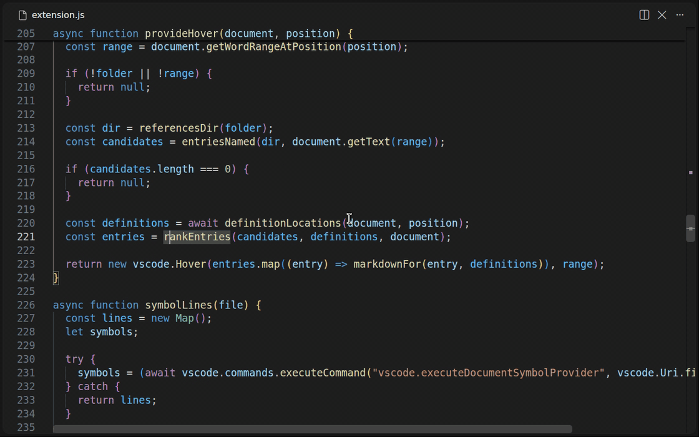

<p align="center">
  
</p>

<h1 align="center">WhatDoesThisDo</h1>

<p align="center">
  <strong>Hover a function or constant and read what it is for, written in markdown pages your AI agent keeps up to date.</strong>
  <br />
  A VS Code and Cursor extension for codebases that grow faster than anyone reads them.
</p>

<p align="center">
  <a href="https://marketplace.visualstudio.com/items?itemName=TonyCJ7.whatdoesthisdo">
    
  </a>
  <a href="https://open-vsx.org/extension/TonyCJ7/whatdoesthisdo">
    
  </a>
  <a href="https://github.com/TonyCJ7/WhatDoesThisDo/actions/workflows/tests.yml">
    
  </a>
  <a href="https://github.com/TonyCJ7/WhatDoesThisDo">
    
  </a>
  <a href="https://github.com/TonyCJ7/WhatDoesThisDo/blob/main/LICENSE">
    
  </a>
</p>

---

## Table of contents

- [The problem](#-the-problem)
- [What is WhatDoesThisDo?](#-what-is-whatdoesthisdo)
- [How it works](#-how-it-works)
- [Getting started](#-getting-started)
- [Let your AI agent write the documentation](#-let-your-ai-agent-write-the-documentation)
- [Writing documentation by hand](#-writing-documentation-by-hand)
- [Settings](#-settings)
- [Performance](#-performance)
- [Local development](#-local-development)
- [Scripts](#scripts)
- [Contributing](#-contributing)
- [Support the project](#-support-the-project)
- [License](#license)

---

## 🧭 The problem

AI agents write code faster than a team can read it. A function lands in the repository, it works, the tests pass,
and a week later someone hovers it and has to read the body to learn what it does. A constant appears with a value
and nobody remembers why that value. The knowledge existed for a moment, in the head of whoever or whatever wrote the
code, and nothing wrote it down.

Code comments were meant to hold that knowledge, but they clutter the file, they go stale next to the code they
describe, and an agent asked to write them tends to restate the line below.

## ✨ What is WhatDoesThisDo?

WhatDoesThisDo is an editor extension that shows documentation for your own functions and constants when you hover
them. The documentation lives in markdown pages inside the repository, one page per source file, and the pages can be
written by the same AI agent that writes the code, in the same change, while it still knows why.

- **Hover in every language.** TypeScript, Python, Rust, Go, Ruby, shell, PHP, YAML or anything else the editor can
  open. The extension asks the editor for the word under the cursor using that language's own rules.
- **Pages are plain markdown.** They read well on GitHub, their links jump to the source line, and they diff in pull
  requests like any other file.
- **The agent keeps them true.** A one-line setup installs a skill and a rule for Claude Code and Cursor. The agent
  reads the entry before changing a function and updates it after, as part of the same change.
- **Definition-aware when a language server is running.** Two functions called `save` in different files each show
  their own entry.
- **Fast on large projects.** An in-memory index is built when the window opens and refreshed per page when a page
  changes. Two thousand pages still answer a hover in a few milliseconds.

---

## 🎬 How it works

<!-- Recording to add here once made; docs/assets/README.md describes it:
<p align="center">
  
</p>
-->

1. You rest the mouse on a name in any file.
2. The extension looks the word up in its index of `docs/whatdoesthisdo/references/`, reads the page that holds it,
   and shows the entry under the editor's own hover. The heading in the entry is a link to the source line.
3. If no page has an entry for the word, the extension adds nothing and the editor's hover is left as it was.

When the same name is documented in several files, the extension asks the editor's language server where the symbol
under the cursor is defined and shows the entry for that file. Without a server, or when no entry points at the file
the server named, it shows every entry for the name, each with its link, with entries from files of the same type
first.

---

## 🚀 Getting started

### 1. Install the extension

Open the Extensions view in your editor, search for **WhatDoesThisDo**, and install it. VS Code finds it on the
[Visual Studio Marketplace](https://marketplace.visualstudio.com/items?itemName=TonyCJ7.whatdoesthisdo) and Cursor
finds it on [Open VSX](https://open-vsx.org/extension/TonyCJ7/whatdoesthisdo); the same extension is published to both.
Nothing else is needed, since it has no runtime dependencies and nothing to configure.

From a terminal:

```bash
code --install-extension TonyCJ7.whatdoesthisdo      # VS Code
cursor --install-extension TonyCJ7.whatdoesthisdo    # Cursor
```

### 2. Set up your AI agent

In your own project, run the installer for your operating system. A welcome screen says what it does, then three
screens ask which agent to set up, this project or every project, and where the pages live, with the arrow keys to
move, enter to select, `b` to go back and `q` to quit. A summary shows every choice and the files it will write and
lets you jump back to any step. After writing it reminds you to reload the editor, since skills and rules are read
when a session starts.

macOS:

```bash
sh -c "$(curl -fsSL https://raw.githubusercontent.com/TonyCJ7/WhatDoesThisDo/main/setup/setup-macos.sh)"
```

Linux:

```bash
sh -c "$(curl -fsSL https://raw.githubusercontent.com/TonyCJ7/WhatDoesThisDo/main/setup/setup-linux.sh)"
```

Windows, in PowerShell:

```powershell
irm https://raw.githubusercontent.com/TonyCJ7/WhatDoesThisDo/main/setup/setup-windows.ps1 | iex
```

Or paste the contents of [`agent/PROMPT.md`](agent/PROMPT.md) into Claude Code or Cursor and let the agent do the
setup. It asks the same questions and copies the same files.

### 3. Hover

Ask the agent to write or change a function. It writes the entry on the file's page in the same change. Hover the
name and read it.

If you want to see it work before involving an agent, write one page by hand as described in
[Writing documentation by hand](#-writing-documentation-by-hand).

---

## 🤖 Let your AI agent write the documentation

The agent setup writes two things. Claude Code and Cursor both read them.

| | Project scope | Global scope |
|---|---|---|
| The `whatdoesthisdo` skill | `.claude/skills/whatdoesthisdo/SKILL.md` | `~/.claude/skills/whatdoesthisdo/SKILL.md` |
| The rule for Claude Code | a marked block in `CLAUDE.md` | a marked block in `~/.claude/CLAUDE.md` |
| The rule for Cursor | `.cursor/rules/whatdoesthisdo.mdc` | printed for you to paste into Cursor Settings, Rules, User Rules |
| The references folder | created with a short `README.md` if missing | not touched |

The **skill** is the full instruction: where the pages live, how they are named and structured, the page format, how
to compute the link to a source line, and what a good entry says. It also tells the agent to read the entry before
touching a function and to update the entry in the same change as the code. Its text is
[`agent/skill/SKILL.md`](agent/skill/SKILL.md).

The **rule** is three sentences that are always in the agent's context and point at the skill, so the agent reaches
for it without being asked. Its text is [`agent/rule-block.md`](agent/rule-block.md).

The naming and folder structure the skill prescribes are the same ones described in the next section, so pages written
by an agent and pages written by hand end up in the same places.

Running the setup a second time replaces the marked block instead of adding another. The scripts also accept
`--agent`, `--scope`, `--folder` and `--yes` (`-Agent`, `-Scope`, `-Folder`, `-Yes` on Windows) to skip the screens,
for scripts and CI.

---

## ✍️ Writing documentation by hand

You can write or edit any page yourself. The extension reads every `.md` file under the references folder, so a page
written by hand and a page written by an agent are the same thing to it.

### Folder structure and naming

Pages mirror the source tree. Each source file has one page, at the same path under the references folder, with the
extension replaced by `.md`.

```
your-project/
├── src/
│   ├── config.ts
│   └── figma/
│       └── urls.ts
├── scripts/
│   └── release.py
└── docs/
    └── whatdoesthisdo/
        └── references/
            ├── README.md              # what the folder is for; the installer writes it
            ├── src/
            │   ├── config.md          # documents src/config.ts
            │   └── figma/
            │       └── urls.md        # documents src/figma/urls.ts
            └── scripts/
                └── release.md         # documents scripts/release.py
```

Inside a page:

- The first line is `## ` and the source path in backticks, for example `` ## `src/figma/urls.ts` ``.
- Each function, method or class is a `### ` entry, in the order it appears in the source.
- Constants go at the end under a `## Constants` heading, one bullet each.

The extension itself does not enforce this layout. It reads any `.md` file in the folder or its subfolders. The layout
is what lets a reader, and an agent, find the page for a file without searching.

### Page format

```markdown
## `src/config.ts`

### [readPositiveNumber(env, name, fallback)](../../../../src/config.ts#L5)

Reads one env variable as a number that must be above zero.

- In: the env, the variable name, the default.
- Out: the default when unset or empty; otherwise the number.
- Refuses: `"abc"`, `"0"`, with `<name> must be a positive number, got "<value>"`.

### [notAFigmaLink(input)](../../../../src/config.ts#L31), [notANodeId(id)](../../../../src/config.ts#L48)

Build the two error objects. Every name in the heading gets this entry.

## Constants

- [`FILE_KEY`](../../../../src/config.ts#L4): alphanumeric, 10 to 64 characters.
```

### Rules the parser follows

- A `### ` heading starts an entry. Every `[name(...)](link)` in the heading becomes a key, paired with its link. The
  key is the text before the opening parenthesis, in whatever spelling the language uses: `save`, `$user`, `my-func`,
  `--brand`. A name ending in `?` or `!` is also registered without the mark, because most editors' word patterns stop
  before it.
- The entry is the heading line plus every line until the next `### `, `## `, or constant bullet.
- A bullet `- [` + backticked name + `](link): text` is a one-line entry for a constant.
- Links are relative to the page, as in any markdown file, and end in `#L<line>` of the declaration. From the
  references folder itself the repository root is `../../../`. Add one `../` for each subfolder the page sits in, so
  `references/src/config.md` uses `../../../../`. The links are clickable in the hover, and the file part of the link
  is what the definition match compares against.
- A heading can list several names when they share an explanation. Each gets its own link.

### What makes a good entry

Two to five lines a reader can trust: what it is for, what goes in, what comes out, what it refuses and with which
message. Write down the intent, since the code already shows the mechanics.

---

## ⚙️ Settings

| Setting | Default | Meaning |
|---|---|---|
| `whatDoesThisDo.folder` | `docs/whatdoesthisdo/references` | Folder, relative to each workspace folder, whose markdown pages hold the entries. Subfolders are read. In a multi-root workspace each folder has its own. |

---

## ⚡ Performance

The index is built from the pages when the window opens and kept in memory as a map from name to page, without the
entry text. Before every hover the extension checks each page's modification time and size and re-reads only the pages
that changed, so an edit shows up on the next hover. Measured on 500 pages with 50,000 entries, a hover takes about
5 ms after the index exists and the index itself holds under 6 MB. The extension writes nothing to disk.

---

## 💻 Local development

Requires Node.js 22 or later (`.nvmrc` pins 22).

```bash
git clone https://github.com/TonyCJ7/WhatDoesThisDo.git
cd WhatDoesThisDo
npm install
npm test
npm run test:editor
```

Open the folder in VS Code or Cursor and press F5 to run the extension from source in a second editor window.

To install a local build instead of the published one, `npm run package` writes `whatdoesthisdo-<version>.vsix`, and
`code --install-extension whatdoesthisdo-<version>.vsix` installs it. For Cursor use the `cursor` command, or on macOS
`"/Applications/Cursor.app/Contents/Resources/app/bin/cursor"`. Then run "Developer: Reload Window".

`npm run test:editor` downloads a stock VS Code build into `.vscode-test/` on first run and runs the hover tests inside
it, against the fixture workspace in `test/fixture/`, in two launches configured by `.vscode-test.mjs`:

- `builtin` runs with other extensions disabled. TypeScript and JavaScript use the bundled server and pick the entry by
  definition. Python, Rust, Ruby, shell, PHP, Go, YAML and plain text have no server there and show every entry for the
  name, same file type first, including each language's word shape. It also edits a page mid-run to check the index
  refreshes and reads pages from subfolders.
- `servers` installs Pylance and rust-analyzer from the marketplace and checks that Python and Rust pick the entry by
  definition. It needs network access and `cargo`.

The installer scripts have their own tests, run against temporary repositories on each operating system by the
Tests workflow on GitHub.

---

## Scripts

| Command | Description |
|---|---|
| `npm test` | Parser tests, Node's built-in runner |
| `npm run test:editor` | Both editor launches inside a downloaded VS Code |
| `npx vscode-test --label builtin` | The editor launch that needs no network |
| `npm run package` | Build `whatdoesthisdo-<version>.vsix` with `@vscode/vsce`; `.vscodeignore` says what stays out |
| `sh setup/test-setup.sh setup/setup-macos.sh` | Installer test, also with `setup-linux.sh` or `SH=dash` |
| `pwsh setup/test-setup.ps1` | Windows installer test |

**Verify before opening a PR:** `npm test && npx vscode-test --label builtin`

---

## 🤝 Contributing

Thanks for helping. The extension is small on purpose: one parser, one hover provider, no runtime dependencies.

### Pull requests

1. **Branch from `main`** with a short kebab-case name: `feature/<topic>`, `fix/<topic>` or `docs/<topic>`.
2. **One concern per PR.** Split unrelated changes so each is easy to review and revert.
3. **Run the checks before you push:** `npm test && npx vscode-test --label builtin`. Run `npm run test:editor` when
   you touch the definition lookup, and the installer test for your OS when you touch `setup/` or `agent/`.
4. **Describe what changed and why.** For a bug fix, include the steps that reproduce it before your change. For a
   hover change, a screenshot of the before and after hover helps.
5. **Add a line to `CHANGELOG.md`** under the next version, and keep this README true when behaviour changes.

### Code style guidelines

| Topic | Guideline |
|---|---|
| **Comments** | Clear names and small functions instead of comments. A comment is for a why the code cannot express. |
| **Dependencies** | None at runtime. A dev dependency is fine when it earns its place; open an issue first for a new one. |
| **Pure logic** | Anything that does not need the `vscode` module goes in `parse.js` or a new pure module, with a test in `parse.test.js`. |
| **Editor behaviour** | Gets a case in `test/builtin.test.js` or `test/servers.test.js`, with a fixture file and a page entry rather than a mock. |
| **Installers** | Three separate scripts by design, one per operating system. A change to the questions or the written files is made in all three; the Tests workflow runs each. |
| **Agent content** | `agent/` is the single source for the skill, rule and prompt. The scripts copy it, they do not carry their own text. |
| **Scope** | The smallest change that solves the request. No speculative options or abstractions without a second user. |

### Reporting issues

Open a [GitHub issue](https://github.com/TonyCJ7/WhatDoesThisDo/issues) with:

1. **What happened and what you expected.**
2. **The page entry and the file you hovered**, with the language and whether a language server was running for it.
3. **What the hover showed**, as text or a screenshot.
4. **Environment:** editor and version, operating system, and the output of `node -v` if the build is involved.

A minimal fixture that reproduces the problem in `test/fixture/` is the fastest route to a fix.

---

## ❤️ Support the project

If WhatDoesThisDo saves you some reading, please consider:

- ⭐ **[Star the repository](https://github.com/TonyCJ7/WhatDoesThisDo)** on GitHub.
- 🤝 **[Contribute](#-contributing)** with an issue or a pull request.
- ☕ **Donate:**

<p align="center">
  <a href="https://ko-fi.com/tonycj07" target="_blank" rel="noopener noreferrer">
    
  </a>
</p>

---

## License

This project is licensed under the [MIT License](LICENSE).
